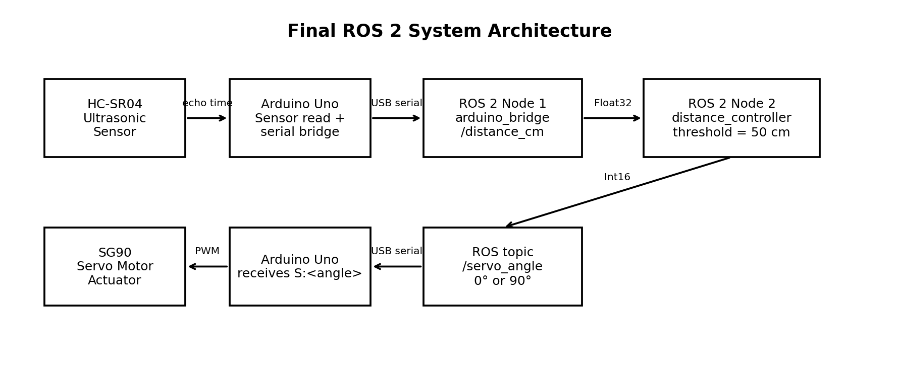
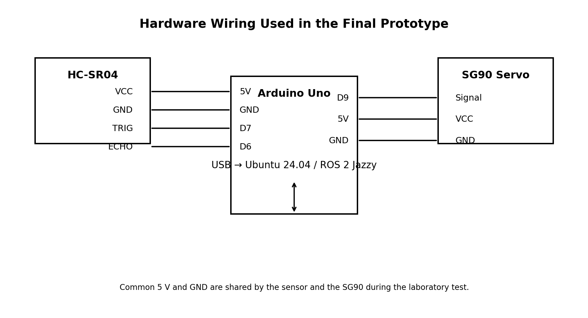

# ROS 2 Ultrasonic Servo Control

**Author:** Kaldybekov Adilkhan

Assignment #02 project for **Actuators, Sensors and Signals**.

The project uses an **HC-SR04 ultrasonic sensor**, **Arduino Uno**,
**SG90 servo motor**, and **ROS 2 Jazzy**. The Arduino handles low-level
sensor/actuator I/O, while ROS 2 performs the control decision using two
nodes.



## System behavior

-   If the measured distance is **50 cm or less**, the servo moves to
    **90°**.
-   If the measured distance is **greater than 50 cm**, the servo moves
    to **0°**.
-   The threshold and servo angles are ROS 2 parameters and can be
    changed without editing the Arduino sketch.

## ROS 2 nodes

### 1. `arduino_bridge`

This node communicates with the Arduino Uno through USB serial.

**Publisher** - `/distance_cm` --- `std_msgs/msg/Float32`

**Subscriber** - `/servo_angle` --- `std_msgs/msg/Int16`

The Arduino sends distance data in this format:

``` text
D:61.5
```

The ROS bridge sends servo commands back to the Arduino in this format:

``` text
S:90
```

### 2. `distance_controller`

**Subscriber** - `/distance_cm` --- receives ultrasonic distance.

**Publisher** - `/servo_angle` --- publishes the required servo angle.

Control logic:

``` text
distance <= 50 cm  ->  servo = 90°
distance >  50 cm  ->  servo = 0°
```

## ROS graph

``` text
HC-SR04
   |
   v
Arduino Uno
   |
   | USB Serial
   v
arduino_bridge
   |
   | /distance_cm
   v
distance_controller
   |
   | /servo_angle
   v
arduino_bridge
   |
   | USB Serial
   v
Arduino Uno
   |
   v
SG90
```

## Hardware

-   Arduino Uno
-   HC-SR04 ultrasonic sensor
-   SG90 micro servo
-   Jumper wires
-   USB cable
-   Ubuntu 24.04
-   ROS 2 Jazzy

## Wiring



  Component   Pin                 Arduino Uno
  ----------- ------------------- -------------
  HC-SR04     VCC                 5V
  HC-SR04     GND                 GND
  HC-SR04     TRIG                D7
  HC-SR04     ECHO                D6
  SG90        Signal              D9
  SG90        VCC (red)           5V
  SG90        GND (brown/black)   GND

For a lightly loaded SG90, the Arduino 5V rail is sufficient for this
demonstration. If the servo is heavily loaded or causes resets, use a
suitable external 5V supply and connect its GND to Arduino GND.

## Software requirements

Tested project environment:

-   Ubuntu 24.04
-   ROS 2 Jazzy
-   Python 3
-   `pyserial`
-   Arduino IDE
-   Arduino `Servo` library

Install the required Ubuntu packages:

``` bash
sudo apt update
sudo apt install python3-serial python3-colcon-common-extensions
```

Load ROS 2:

``` bash
source /opt/ros/jazzy/setup.bash
```

## 1. Upload the Arduino sketch

Open:

``` text
arduino/ultrasonic_servo_bridge/ultrasonic_servo_bridge.ino
```

in Arduino IDE.

Select:

``` text
Board: Arduino Uno
Port: your Arduino port
```

Upload the sketch.

After uploading, **close Arduino Serial Monitor** because ROS 2 needs
exclusive access to the serial port.

## 2. Find the Arduino serial port

On the tested computer the Arduino appeared as:

``` text
/dev/ttyUSB0
```

Check with:

``` bash
ls /dev/ttyUSB*
ls /dev/ttyACM*
```

If you get `Permission denied`, add your user to `dialout`:

``` bash
sudo usermod -aG dialout $USER
```

Then log out and log back in.

## 3. Build the ROS 2 package

From the repository root:

``` bash
cd ros2_ws
source /opt/ros/jazzy/setup.bash
colcon build --packages-select ultrasonic_servo
source install/setup.bash
```

## 4. Run the complete system

The easiest method is the included launch file:

``` bash
ros2 launch ultrasonic_servo ultrasonic_servo.launch.py
```

This starts both:

``` text
/arduino_bridge
/distance_controller
```

The launch file uses `/dev/ttyUSB0` at `115200` baud by default.

## Run the nodes separately

Terminal 1:

``` bash
cd ros2_ws
source /opt/ros/jazzy/setup.bash
source install/setup.bash
ros2 run ultrasonic_servo arduino_bridge
```

Terminal 2:

``` bash
cd ros2_ws
source /opt/ros/jazzy/setup.bash
source install/setup.bash
ros2 run ultrasonic_servo distance_controller
```

## Use a different serial port

For example, if the Arduino appears as `/dev/ttyACM0`:

``` bash
ros2 run ultrasonic_servo arduino_bridge --ros-args -p port:=/dev/ttyACM0
```

## Change the distance threshold

Example: trigger at 70 cm instead of 50 cm:

``` bash
ros2 run ultrasonic_servo distance_controller --ros-args -p threshold_cm:=70.0
```

You can also change the angles:

``` bash
ros2 run ultrasonic_servo distance_controller --ros-args \
  -p threshold_cm:=50.0 \
  -p near_angle:=90 \
  -p far_angle:=0
```

## ROS 2 verification

List nodes:

``` bash
ros2 node list
```

Expected:

``` text
/arduino_bridge
/distance_controller
```

List topics:

``` bash
ros2 topic list
```

Important topics:

``` text
/distance_cm
/servo_angle
```

Watch sensor values:

``` bash
ros2 topic echo /distance_cm
```

Watch servo commands:

``` bash
ros2 topic echo /servo_angle
```

## Optional serial test

Before running ROS 2, the included script can test communication with
the servo:

``` bash
python3 tools/serial_servo_test.py
```

It opens `/dev/ttyUSB0`, sends `S:90`, waits, sends `S:0`, and then
prints several distance samples.

Do not run this test while `arduino_bridge`, Arduino Serial Monitor, or
another program is using the same serial port.

## Project structure

``` text
ros2_ultrasonic_servo_project/
├── README.md
├── .gitignore
├── arduino/
│   └── ultrasonic_servo_bridge/
│       └── ultrasonic_servo_bridge.ino
├── ros2_ws/
│   └── src/
│       └── ultrasonic_servo/
│           ├── launch/
│           │   └── ultrasonic_servo.launch.py
│           ├── resource/
│           │   └── ultrasonic_servo
│           ├── ultrasonic_servo/
│           │   ├── __init__.py
│           │   ├── arduino_bridge.py
│           │   └── distance_controller.py
│           ├── package.xml
│           ├── setup.cfg
│           └── setup.py
├── tools/
│   └── serial_servo_test.py
└── docs/
    ├── Assignment_02_Original.pdf
    ├── Assignment_02_Report_Kaldybekov_Adilkhan.docx
    ├── architecture.png
    └── wiring.png
```

## Documents

The `docs` directory contains:

-   the original Assignment #02 PDF;
-   the completed report for Kaldybekov Adilkhan;
-   wiring and ROS architecture diagrams.

## Expected demonstration

1.  Start both ROS 2 nodes.
2.  Keep an object farther than 50 cm from the ultrasonic sensor: SG90
    stays at 0°.
3.  Move the object within 50 cm: `/distance_cm` falls below the
    threshold.
4.  `distance_controller` publishes `90` to `/servo_angle`.
5.  `arduino_bridge` sends `S:90` to the Arduino.
6.  The SG90 rotates to 90°.
7.  Move the object away again: the servo returns to 0°.
